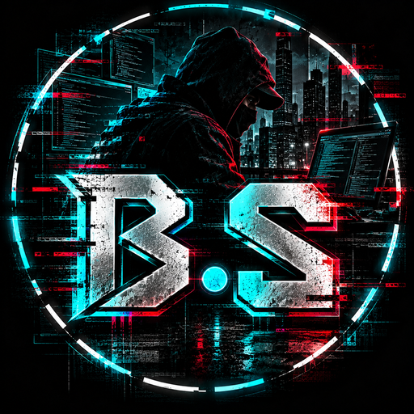

<p align="center">
  
</p>

<h1 align="center">bayo.sh</h1>

<p align="center"><b>Animated video wallpapers for your PS5 home screen.</b></p>

<p align="center">
  
  
  
  
</p>

<p align="center"><a href="README.md">🇲🇽 Español</a> · <b>🇺🇸 English</b></p>

---

## What it does

- **Your video as the wallpaper** on the PS5 home screen, instead of the static image.
- **Per-game wallpaper**: each game can have its own video when it is highlighted.
- **Effects**: dim, blur, gradients, vignette, haze and parallax.
- **Sound** for videos that have audio, with volume control.
- **Pauses while you play**, so the game gets the whole video decoder.
- **Normal background in Settings** and a **PlayStation Store only** mode.
- **Shuffle**: a different video on every start.
- **Rest mode**: comes back on its own when the console wakes up.
- **App on the home screen** (Media) to control everything with the controller.
- **From your phone or PC**: open `http://PS5-IP:9050` to upload videos and control everything.
- **Controller light**: the DualSense LED follows your wallpaper's color, or use Solid, Rainbow, Breathing or Wave modes.
- **Any video**: if it is not compatible (4K, HEVC, 60+ fps…), the **Convert and apply** button turns it into 1080p from your phone or PC.
- **Download from a link**: paste an .mp4 link and the PS5 downloads it to your wallpapers.
- **Your wallpaper sites**: add the pages or repos you like; they are saved on the PS5.
- **Background music** on the phone/PC page (original dark fantasy track, one tap to turn off).
- **First-run guide** inside the app.
- **10 languages**: Español, English, Português, Français, Deutsch, Italiano, 日本語, 한국어, 中文, Русский.
- **etaHEN compatible** on firmware 13.60: it does not change the menu's permissions or read the kernel from inside, and if something fails it stops itself instead of crashing the console.

## Installation

You need a jailbroken PS5 and a payload loader.

1. Copy your `.mp4` videos to `/data/bayosh/video/` (over FTP), or to a `bayosh` folder on a USB drive.
2. Load `bayosh.elf` ([download the latest release](https://github.com/bayo-labs/bayo.sh/releases/latest)).
3. Open **bayo.sh** in Media, pick your video in **Wallpapers** and press **Use**.

You can also upload videos from your phone: open `http://PS5-IP:9050` in the browser (same Wi-Fi network).

**Recommended format:** `.mp4` H.264, 1920×1080, up to 60 fps. To convert any video on Windows, drag it onto `tools/convert_for_ps5.bat` (needs `ffmpeg.exe`).

**In-app controls:** L1 / R1 switch sections, ○ closes windows.

### Before you use it

- Test it for a few days by launching it manually before adding it to your autoload.
- The first time it creates an empty folder at `/system_ex/vsh_asset/wallpaper`. It does not modify Sony's files.
- If something goes wrong, reboot without loading the exploit and the console starts normally.
- The log is saved at `/data/bayosh/bayosh.log`. Attach it when you report a problem.

## Building

On Linux or WSL, with:

- [ps5-payload-sdk](https://github.com/ps5-payload-dev/sdk) (tested with v0.44) and clang 18
- [OnionHEN](https://github.com/aydencharles/onionHEN) at tag `v0.9.0-beta2`

```bash
git clone https://github.com/aydencharles/onionHEN.git ~/onionHEN
git -C ~/onionHEN checkout v0.9.0-beta2
ONIONHEN=~/onionHEN PS5_PAYLOAD_SDK=~/ps5-payload-sdk tools/build.sh
```

The result is `dist/bayosh.elf`. The script applies `patches/onionhen-detour.patch` (needed for etaHEN), copies `src/` into the OnionHEN tree and builds the `bayosh` target.

### Layout

| File | What it is |
|---|---|
| `src/bayosh_daemon.cpp` | The payload: lists videos, mounts the folder, injects the module into the menu and watches it |
| `src/bayosh_shellui.cpp` | The module that runs inside the PS5 menu and plays the wallpaper video |
| `src/bayosh_web.cpp` | Web server on port 9050 (the app and the phone page) |
| `src/bayosh_tile.cpp` | The app's tile on the home screen |
| `src/bayosh_page.html` | The interface (PS5, PC and phone) |

### API (port 9050)

`/api/state`, `/api/select?i=`, `/api/on`, `/api/off`, `/api/dim?v=`, `/api/volume?v=`, `/api/blur?v=`, `/api/look?k=&v=`, `/api/set?k=&v=`, `/api/games`, `/api/gamebg?tid=&i=`, `/api/delete?i=`, `POST /api/upload?name=`, `/api/reset`, `/api/shutdown`, `/video?i=`, `/thumb?i=`, `/gameicon?tid=`.

## Bug reports and ideas

Open an [issue](https://github.com/bayo-labs/bayo.sh/issues) in English or Spanish, and attach `/data/bayosh/bayosh.log`.

## Credits

Made by **Josué** · BayoTech.

bayo.sh is a derivative project. The video engine starts from **LiveShell** by ZiZc3 and uses the injector, libraries and groundwork of **[OnionHEN](https://github.com/aydencharles/onionHEN/)**. bayo.sh's changes are listed in [CHANGELOG.md](CHANGELOG.md) (Spanish).

## License

GPL-3.0. See [LICENSE](LICENSE). Provided without any warranty; use it at your own risk.
